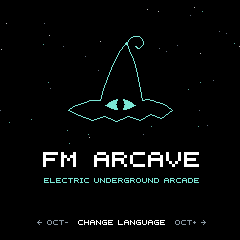

# FM ARCAVE

**The Mystic Arcave on the M-VAVE FM-1: a music game you play with the knobs and the keys.**

<p align="center"></p>

Wake up Rock, roll down to the cave, and mend the jukebox with a song of your own. Then the arcade is yours: three
machines, free play, and a jukebox on the ALGORITHM knob.

- **The page:** <https://mystic-arcave.github.io/FM-Arcave/>
- **Play it in the browser:** [the emulator](https://mystic-arcave.github.io/FM-Arcave/emu/), the firmware's own code built for the web.
- **Install it on an FM-1:** [the installer](https://mystic-arcave.github.io/FM-Arcave/install/), over USB from Chrome or Edge.
- **Several FM-1s in time:** [the Link page](https://mystic-arcave.github.io/FM-Arcave/link/), see [docs/LINK.md](docs/LINK.md).

> **Status: 0.3.** 0.1 and 0.2 were installed from the installer page and played on a newer FM-1 (the one with M-VAVE
> printed under the screen). 0.3 adds the controls sheets, a fourth ring, button blocks in MYSTIC RUN, JUICE WORKS in place of THE LIGHT TABLE, the race back, the scores board,
> FX and child ear protection; it is tested in the browser build and in scripted runs, not yet on the device. Installing it is at your own
> risk; the way back is any other firmware's installer, or OCT- held at power-on (the USB rescue).

## The game

| | |
| --- | --- |
| **The intro** | The title, then "press PLAY to wake up Rock". Any of the seven knobs rolls the rock; the keys jump, the bottom row a hop, the top row a big one. Launch pads (white piano keys set into the hill), jelly caps, star rings, and a secret behind the start, hidden by a rock face. The opening course is half the length of the one raced back from the Arcave's upper door. |
| **The cave** | A platforming hub with no music, only a low hum and the sounds Rock makes. Both ends of the floor are ramps with a booster; springy caps and the boosters reach three things hidden high up. Someone calls from off the screen: the Hat, a wizard's hat with no body. The jukebox that powered the three arcade machines has gone out; it stands past the Hat under its name, in a dip that holds a slow Rock. The left booster is unmarked; it throws Rock up to a ledge whose far end is a small room with a door back outside. Through it the course becomes a **race back**: a start line, a clock, the pads and boosters turned round, to where the game began. The best time is kept with the scores. |
| **The mending** | Four rings of glass, each with a crack: KNOB 1, 2, 3, 4 turn them until the light gets out. Then the dish: slide a hand a long way along the keys (or turn a knob) to spin it at the hand's speed, hold a speed for eight beats and that is your tempo. KNOB 1, 2, 3, 4 then set the song's echo, reverb, distortion and chorus (HOME explains them). Once the jukebox is mended, PLAY at it records a new song the same way. REC, and two bars of keys are your first song. The power comes back with it. |
| **Free play** | ALGORITHM changes the tune; a banner slides in from the top with its name. The machines: **MYSTIC RUN** (hop crystals on the beat; a block goes only when you press the button that lights up), **JUICE WORKS** (four taps of mushroom juice on KNOB 1-4, glasses put down, moved and served with the keys, tickets that show the layered drink to pour: several things to keep going at once), **NIGHT BLOOM** (new: KNOB 1, SELECT, KNOB 2 and ALGORITHM each turn a petal, a click a twenty-fourth of a turn; catch each spore on its own colour). In a machine PLAY starts, HOME shows how it is played, REC goes back to the Arcave. A board up on the third machine's ledge lists the best scores and the time played. |

Everywhere: **GLO** opens the settings over the paused game (language, text size, child ear protection, look, LINK, about, replay the
intro, skip to the Mystic Arcave, start over; in there PLAY or OCT+ confirms); held for a second it warns, and held three seconds more it wipes the whole save. **OCT-** and **OCT+** step through English, German, Danish, French, Spanish and Turkish. **HOME** shows the controls (on the course and in a machine). **EDIT** shows the scores and the time played. **FX** plays one
of a dozen effects, picture and sound.

## Build it

```
python3 tools/gen_tables.py && python3 tools/gen_course.py   # the tables (already in firmware/gen)
tests/run_arcave.sh intro            # the game on this computer: build/host/intro.png (screens), intro.wav
web/emu/build.sh 0.1                 # the browser build (needs Emscripten's emcc)
./build.sh                           # the FM-1 package build/fm-arcave.fwsc (toolchain: see docs/MAKE-IT-YOURS.md)
python3 tools/make_site.py 0.1 build/fm-arcave.fwsc    # the whole site in build/site
sh tests/run_arcave_tests.sh         # every test; none needs an FM-1
```

The chip has no floating point and no 64-bit division, so the game is whole numbers throughout
([docs/RULES.md](docs/RULES.md)). The picture is drawn into RAM and only the rows that changed go to the screen.

```
firmware/src/arcave/     the game: ac_base.h (drawing, font, input), ac_synth.h (voices, echo, the clock),
                         ac_music.h (tunes), ac_text.h (six languages), ac_intro.h, ac_cave.h, ac_juke.h (rings, dish),
                         ac_mach.h (three machines), ac_sync.h (LINK), ac_menu.h, arcave.c
firmware/src/fm_arcave.c the FM-1 app: Dinghy's platform under the game
firmware/src/, hal/      Dinghy's platform (updates, USB rescue, MIDI, audio, keys, screen, storage); dinghy.c is its sample app
web/emu/                 the browser FM-1 (web_host.c, worklet.js, panel.js)
web/site, install, link  the pages; tools/make_site.py puts them together
tools/gen_course.py      the intro's land and everything on it, worked out from the prototype's formulas
tests/scripts/           scripted playthroughs; tests/run_arcave_tests.sh runs them all
```

## Releasing

A tag `vX.Y` builds the package, runs the tests and publishes a release with a build attestation
(`.github/workflows/release.yml`). Every push to `main` publishes the site with the emulator
(`.github/workflows/pages.yml`; set Settings > Pages > Source to "GitHub Actions" once). The package's identity is
`FM-1_96N`; pick another in `tools/build.py` if the [Firmware Hub](https://thefirmwarehub.com) lists that one.

## Credits

FM ARCAVE is by benjamuels (Mystic Arcave), from the Mystic Arcave installation. It is built on [Dinghy](https://github.com/zvenson/dinghy)
by zvenson, which carries the platform of [Felucca](https://github.com/hugelton/Felucca) by Leo Kuroshita (Hügelton
Instruments) as [SLOOP](https://github.com/isod89/sloop-fm1) (isod89) has it. The rings and the dish are after UMBRA
OBSCURA. Everything is GPL-3.0-only; [LICENSING.md](LICENSING.md) says who made what.

FM ARCAVE is not made or endorsed by M-VAVE.
